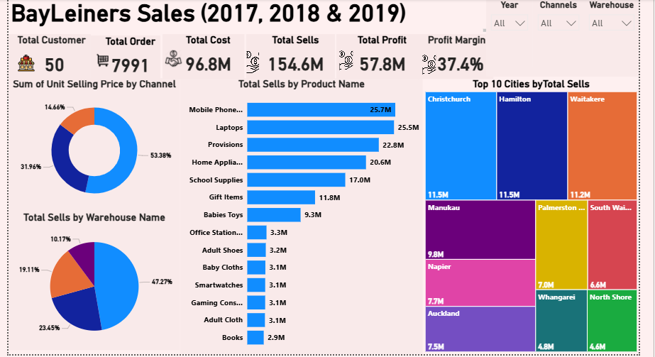
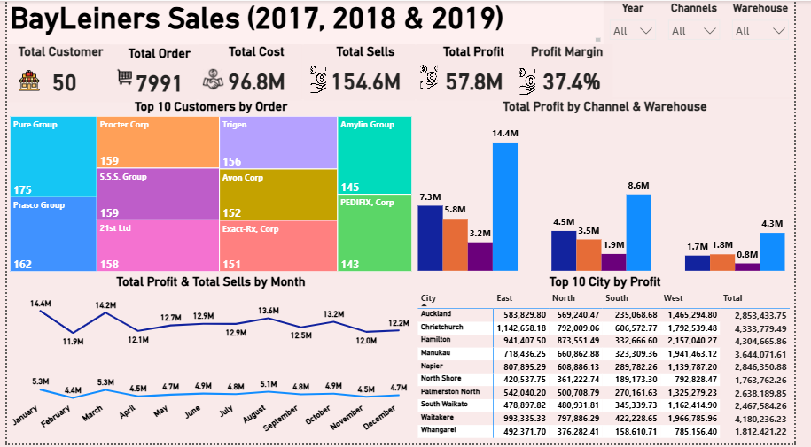
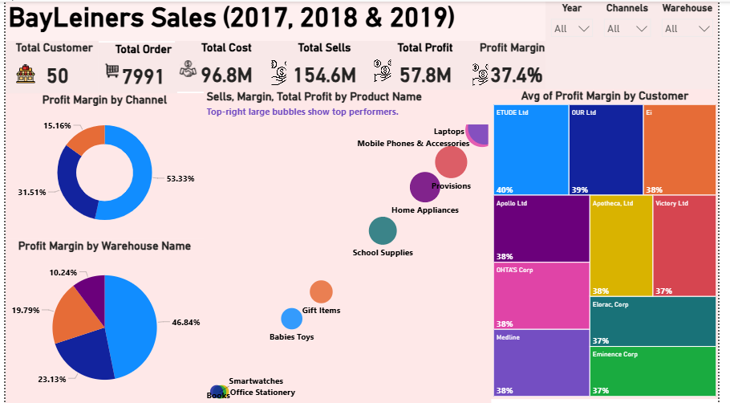

# 📊 BayLeiners Sales Dashboard (2017–2019)

## 🔎 Project Overview

The BayLeiners Sales Dashboard analyzes business performance between 2017 and 2019, providing insights into sales, costs, profits, and profitability across products, customers, sales channels, warehouses, and cities.

## 🎯 Project Objectives

- Analyze sales, costs, profits, and profit margins.
- Identify top-performing products, customers, and cities.
- Examine sales channel and warehouse performance.
- Understand business performance over time.

## 📌 Key Performance Indicators (KPIs)

- **Total Customers:** 50
- **Total Orders:** 7,991
- **Total Sales:** 154.6M
- **Total Cost:** 96.8M
- **Total Profit:** 57.8M
- **Profit Margin:** 37.4%

## 🛠️ Tools Used

- **Power BI:** Dashboard development, data visualization, and analysis.
- **Power Query:** Data cleaning and transformation.

## 💡 Key Insights

- One sales channel contributes 53.6% of total sales.
- Mobile Phones and Laptops are among the leading products by sales.
- The East Warehouse shows strong profitability.
- Overall profit margin is 37.4%.

## 🚀 Recommendations

- Explore opportunities to diversify sales channels.
- Review warehouse performance to identify areas for improvement.
- Focus on products with stronger profit margins.
- Monitor sales and profitability trends to support better business decisions.

## Dashboard Screenshots

### 1. Sales Distribution

### 2. Profitability Analysis

### 3. Profit Margin Analysis

